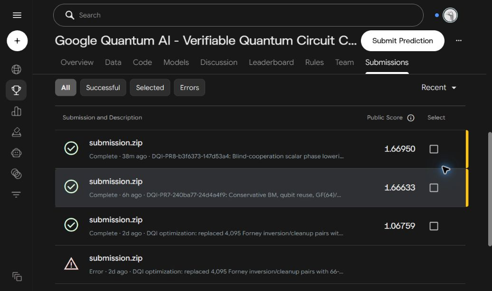

# 盲協力の手続きとDQI第7版から第8版の改善結果

2026年10月27日

第7版を起点としてGeminiと盲協力を行い、Forneyの位相回路を改良した第8版を作成した。完全DQIへの組込み、GitHub Actions、公開公式検証器、Kaggleの公式公開採点まで完了し、Public Scoreは **1.66633から1.66950へ、表示値に基づいて約0.19024%向上**した。DQIのToffoli相当数は4,095減り、量子ビット数2,482を維持して、公開検証器によるDQIコストを約0.568844%削減した。

今回の評価対象は、共同作業によって仕上げた成果物の改善である。Geminiの指摘、こちらの計算や反例、既知回路の再利用、実装上の工夫を往復させ、採用した変更を回路と公式採点で確かめた一事例として記録する。

## 盲協力の手続き

「盲」は、意図的な小さな変更の事実・箇所・想定修正をGeminiへ伏せることを指す。検討に必要な目的、仕様、仮定、制約は共有する。元の完成候補にも見落としがあり得るものとして、相手から出る別の見方や予想外の改善を検討する。

1. **通常の作業と検証を終え、完成候補を保存する。** 対象の版、ソース、回路、検証条件、費用を固定する。比較の出発点を後から再現できる状態にする。
2. **対話用の別コピーに、意味に影響する小さな誤りを一つ入れる。** 符号、境界条件、必要な仮定、依存順序など、内容の議論につながる変更を選ぶ。変更前後を手元に記録し、元の候補から分離する。
3. **目的と前提を添えて、Geminiに改善を求める。** 論理の飛躍、誤り、条件の抜け、別の解法や構成を広く相談する。仕込みの説明や想定解で回答を誘導せず、通常の共同作業として案を渡す。
4. **指摘や提案をこちらでも検討し、根拠を返す。** 有限計算、反例、実装、原典との照合を行い、結果や疑問を同じチャットへ返す。相手の提案とこちらの元の考えを、ともに根拠に応じて修正する。
5. **有益な変更を実装し、新しい完成候補を検証する。** 意図的に入れた誤りを解消する。値、相対位相、入力の復元、作業領域、測定後の補正など、成果物の契約を満たすことを確認する。競技提出物では、全体実装と公式評価まで進める。
6. **改善内容と根拠を対応づけて報告する。** 元の版と新しい版、実際の対話、採否の理由、実行結果、費用、公式採点を保存する。完了は依頼された成果物の要件に照らして判断する。

今回の最初の相談は理論説明だけで始めた。対話が進んだ段階で、具体的な多項式、積の構成、ゲート列、反例、検証結果を追加している。会話Aを継続して使い、後半では会話Bも併用した。

## 今回実際に行った対話

| 段階 | 実際の交換 | 得られた内容 | 成果物への反映 |
| --- | --- | --- | --- |
| 理論の整理 | 会話Aで3往復 | 相対トレースの式、測定後の位相補正、限定された下限の適用範囲を確認 | 理論説明を訂正し、非線形部分と位相の融合へ探索対象を絞った |
| 5積回路の導入 | 同じ会話Aで追加3往復 | 6入力のスカラー関数と既知の5積構成を共有し、親の生存期間と測定補正を検討 | 位相部69から68 Toffoli相当／点の局所候補を実装した |
| ゲート列と補正の改善 | 会話Aで3往復、会話Bで4往復 | clean出力への直接計算、終端積の直接位相化、共通XORと補正の順序を検討 | 68 Toffoli相当を維持し、局所総命令数を5,737から5,629へ減らした |

会話Aは[ブラウザー上のGemini](https://gemini.google.com/app/779e52f9b50a8d07)、会話Bは[Windows上のGemini](https://gemini.google.com/app/3fedcaad74021583)である。保存した表示ラベルはAがAuto、BがFlashだった。交換した本文は[対話記録と出典一覧](../research/blind_cooperation_20261027/evidence.json)から確認できる。

初回の理論説明では、対話用コピーの正しい式 `H = g0*a1 + g1*a0` に、余分な `g1*a1` を加えた。Geminiの初回の展開にも相殺の抜けが残ったため、こちらから具体的な反例と全4,096組の有限体計算を返し、続く対話で式を修正した。元の第7版には正しい式が実装されていたため、この訂正を第8版の回路削減には数えていない。[初回の変更記録](../research/blind_cooperation_20261027/records/initial/private_change_record.json)

後半の会話Bでは、別の対話用コピーで測定清掃の順序を `a4→a3→a2→a1→a0` から逆向きへ変えた。親を先に消すと、子の測定結果に応じた補正に必要な値を失う。こちらで `b=(0,1,1), h=(0,0,0), r=0`、a4の測定結果だけが1となる分岐を調べ、目標にない−1の位相が残ることを確認した。計算結果を通常の疑問・反例として返し、依存関係を検討した。変更の事実と想定修正は対話中に開示していない。[後半の変更記録](../research/blind_cooperation_20261027/records/dual/private_change_record.json)、[位相反例](../research/blind_cooperation_20261027/records/dual/cleanup_counterexample.json)

会話Bの2通目には数学の検討が進まない定型的な返答があった。式を短くした相談で検討を再開し、その後も同じチャットで結果を交換した。新規チャットへの切替えを手続き上の必須条件にはしていない。

## 第7版から第8版で変えた計算

対象は、DQIのForney部分で各点に与える位相である。有限体のノルムとトレースで問題を縮約すると、GF(8)上のBとHについて、次の1ビットを計算すればよい。`inv(0)=0` とし、rは量子の根フラグである。実行時の古典マスクEは別の入力として扱う。

```text
q(B,H) = Tr_GF(8)/GF(2)(H * inv(B))
必要な位相 = (-1)^(r*q)
```

第7版では、GF(8)の逆元側に3個の非線形演算を使い、得られた座標を最後の3個のCCZへ渡していた。この二つを合わせた費用は6 Toffoli相当だった。第8版では、最終的に必要なスカラーqを5個の積から直接作る構成へ置き換えた。全位相部の費用が69から68、根判定11を含めると80から79 Toffoli相当／点となる。

5積のBoolean回路は、[NISTの公開回路集](https://github.com/usnistgov/Circuits/tree/8366158a4324ef902ce740f29ddc9f7ebb1018b2)にあるSLP f121049を再利用した。こちらで実装基底との入力対応を定め、対象のqと全64入力で一致することを確認してからGeminiへ共有した。今回の成果は、この既知構成を位相回路へ組み込み、測定後の補正と作業領域を含めて改良し、完全DQIと公式採点までつないだことである。[出典と構成](../research/bm_port/NIST_f121049.txt)、[共有した内容](../research/blind_cooperation_20261027/records/fusion/prompt_05.txt)

理論対話で確認したトレース対のrank 3による下限は、Hと逆元Zを独立した変数として、各々の線形基底変更だけを行うモデルに対するものだった。今回の変更は、Bから逆元を作る非線形な過程と最終位相を一緒に扱う。そのため、この限定された下限と今回の削減は両立する。

最初の5積候補ではToffoli相当数が減る一方、線形操作と測定の命令数が増えた。後半の共同作業で、次の変更を加えて命令列を改善した。

| 採用した変更 | 変更した理由と確認内容 |
| --- | --- |
| cleanな作業ビットへの直接CCX | 線形項を整理して必要な積を直接保持し、汎用の積生成に付いていた周辺操作を削減した。入力と作業領域の復元をANFで照合した |
| 終端2積の直接CCZ化 | 会話Bの提案を、後続の積計算に使われないt1とt4へ適用した。これらは積を保存せず、根フラグrと直接位相を与えられる。子の計算に必要なt0は保持する |
| 共通XORの再利用 | 会話Aとの検討を具体的なゲート列にし、t2とt3の計算時、および測定補正時に、それぞれ共通の線形結合Sを再利用した |
| 親と子を踏まえた補正順序 | t2とt3の補正を終えるまで親t0を保持する。h0は一度復元して位相を与え、その後Sを再構築して補正する。会話Bの強すぎる保持条件を実際の列で修正した |

この結果、積の値を保持する作業ビットは5本から3本となった。小ブロックは初期の156命令から56命令、さらに48命令へ減った。最終48命令の内訳は、34 CX、3 CCX、2 CCZ、3 CZ、3 HMR、3測定結果条件付きCZである。CCXとCCZを合わせたToffoli相当数は5のままである。[最終ゲート列を返した相談](../research/blind_cooperation_20261027/records/dual/a_prompt_03.txt)、[復元順序を修正した相談](../research/blind_cooperation_20261027/records/dual/b_prompt_04.txt)

| 同じ局所検証ハーネスでの比較 | 第7版 | 最初の5積候補 | 第8版の局所候補 |
| --- | ---: | ---: | ---: |
| 位相部のToffoli相当数／点 | 69 | 68 | 68 |
| 根判定込みのToffoli相当数／点 | 80 | 79 | 79 |
| CX | 5,221 | 5,307 | 5,216 |
| HMR | 87 | 91 | 84 |
| 総命令数 | 5,648 | 5,737 | 5,629 |

最初の5積候補からの命令削減は108、第7版からの正味の削減は19命令／点である。完全DQIには4,095点分を組み込んだため、Toffoli相当数の削減は `1×4095=4095`、総命令数の削減は `19×4095=77805` となった。

## 検証から公式採点まで

局所の正しさは、Pythonによる厳密なBoolean ANFと合成論法で確認した。最終スカラーブロックは7入力ビットと3個の独立測定結果を扱い、入力・作業領域の復元と相対位相を照合した。前後の回路との合成では46個の独立入力、54個の測定結果、82,944個の係数を照合し、実際の物理配線上の命令列とも対応を確認した。これらが確かめる対象は置換した局所回路であり、全体実装には次の確認を行った。

| 確認段階 | 実施済みの結果 | 根拠 |
| --- | --- | --- |
| 回帰と出典 | 41回帰テスト、10出典ファイルの確認がPASS | [全体検証記録](../checkpoints/bm-blindcoop-20261027.json) |
| 完全DQI生成とパース | 第8版の完全回路を生成し、native KickmixパースがPASS | [全体検証のActions](https://github.com/Sumuji-zkdwn/kb-ndtjm/actions/runs/40447516741) |
| 置換範囲と割当 | Forney以外の命令列とレジスタ契約が一致。6,257件の割当イベントは命令位置以外が一致し、Qは2,482 | [対応照合の記録](../checkpoints/bm-blindcoop-20261027.json) |
| 公開公式検証器 | 第8版を102,400 shotsで新規実行し、値・位相エラーとも0。candidate、smoke、full-packageがPASS | [公開検証器の実行記録](../checkpoints/bm-blindcoop-20261027.json) |
| 追加の境界確認 | 55パターン・1,536 shotsで値・位相エラーとも0。深いBM履歴と可変マスクを含む | [追加検証の記録](../checkpoints/bm-blindcoop-20261027.json) |
| 提出物の照合 | ZIP全13ファイルを照合。Kaggleから再取得した第8版ZIPは検証済み版とSHA-256が一致し、第7版と他12ファイルが同一 | [提出物照合](../research/blind_cooperation_20261027/records/official/submitted-package-audit.json) |
| Kaggle公式公開採点 | 第8版がComplete、Public Score 1.66950 | [公式API結果](../research/blind_cooperation_20261027/records/official/official-api/pr8-official-api.json) |

第7版の公開検証器の結果は、[既存の成功した実行](https://github.com/Sumuji-zkdwn/kb-ndtjm/actions/runs/40414437653)について、回路、検証器、設定、上側誤り率と費用を照合して再利用した。第8版は新しい完全回路を実行した。両者の比較条件は102,400 shots、batch size 1,024、seed 20261025、1 worker、log2_delta −128である。値・位相エラーは双方0、費用に使う上側誤り率は双方0.0008660587301657926だった。

| 全体結果 | 第7版 | 第8版 | 差 |
| --- | ---: | ---: | ---: |
| 完全DQIのToffoli相当数 | 719,881 | 715,786 | −4,095 |
| ForneyのToffoli相当数 | 327,600 | 323,505 | −4,095 |
| 完全DQIの総命令数 | 90,986,115 | 90,908,310 | −77,805 |
| 量子ビット数Q | 2,482 | 2,482 | 0 |
| 公開検証器によるDQIコスト | 5,282,883,023,272.201 | 5,252,831,659,254.676 | −0.568844% |
| Kaggle公式Public Score | 1.66633 | 1.66950 | ＋0.00317、約＋0.19024% |
| Kaggle公式採点状態 | Complete | Complete | 両方採点済み |
| Kaggle提出番号 | 57685010 | 57693011 | — |

公開検証器のDQIコストは `R(上側誤り率)×Q²×Toffoli相当数` である。Qと上側誤り率が同じだったため、今回のコスト低下は4,095個のToffoli相当演算の削減に対応する。保存済みの公開metric v10では、3課題のコスト比の幾何平均を総合スコアとしている。今回のKaggle公式採点で、この総合値の向上も確認した。公開metricの保存元とSHA-256は[出典一覧](../research/blind_cooperation_20261027/evidence.json)に記載した。

第8版は2026年10月27日16:11:38 JSTに1回提出し、同日16:48:21 JSTに公式APIでCompleteとスコアを確認した。提出後は同じ受付番号を追跡した。[提出と採点監視のActions](https://github.com/Sumuji-zkdwn/kb-ndtjm/actions/runs/40465609028)、[受付記録](../research/blind_cooperation_20261027/records/official/official-api/receipt.json)



## 今回の結果から判断できること

今回の盲協力を経た第8版は、第7版より少ないToffoli相当数と命令数で同じ契約の回路を実装し、公開公式検証器とKaggleの公式公開採点を通過した。理論上の置換案から、実装、全体検証、公式スコアまで改善がつながった事例である。

改善には、こちらが同定した既知の5積構成、Geminiからの終端位相化や依存関係に関する提案、こちらが作ったゲート列・反例・局所証明、往復による修正が含まれる。初回の式の訂正、具体的回路のない削減予測、適用範囲が広すぎる下限、余分な逆CCXを要する清掃案は、実装上の改善として数えていない。二者のどちらか一方の提案だけに成果全体を帰属させる集計は行わない。

効果として確認したのは、この一組の成果物の変更前後である。意図的な誤りの混入そのものの寄与、二つのGeminiを使ったこと単独の寄与、ほかの課題での一般的な有効性は、この比較では切り分けていない。回路の大域的最小性や実行速度の改善も、この結果からは導かない。公式結果は2026年10月27日に確認したPublic Scoreで、最終Private Scoreは未公開である。

## 証拠と再確認

- [対話の原本との対応とSHA-256一覧](../research/blind_cooperation_20261027/evidence.json)：対話・変更記録・局所検証・公式採点・画像の52ファイルを原本と照合した一覧。
- [第7版の全体検証記録](../checkpoints/bm-tracephase3-20261027.json)、[第8版の全体検証記録](../checkpoints/bm-blindcoop-20261027.json)、[今回の公式採点と比較記録](../checkpoints/kaggle-pr8-public-score-20261027.json)。
- [局所候補の検証記録](../research/blind_cooperation_20261027/records/dual/optimized_verification.json)、[会話Aの最終相談](../research/blind_cooperation_20261027/records/dual/a_prompt_03.txt)、[会話Bの最終相談](../research/blind_cooperation_20261027/records/dual/b_prompt_04.txt)。
- [実装したスカラー回路](../research/bm_port/trace_phase5_scalar.py)、[完全DQIへの接続](../research/bm_port/trace_phase5.py)、[NIST構成の出典](../research/bm_port/NIST_f121049.txt)。

原本の各実験フォルダーは保存時点の状態を保つ。局所候補の記録にある全体実行のNOT_RUN、および全体CI完了時点の記録にあるKaggleのNOT_RUNは、その段階の履歴である。現在の採点結果は上記の公式採点記録に追記している。

第7版の実装は `240ba77a94e01e4d35bc82d936833ae2fbae783f`、第8版の検証済み実装は `b3f6373d10bfec8b4c7a102f774399d2563bfe8f`。DQIと提出ZIPのSHA-256は公式採点の比較記録に保存した。

原本フォルダーを保持したこの作業環境では、次のコマンドで記録のコピー、ハッシュ照合、数値の対応確認を再実行できる。

```text
python research/blind_cooperation_20261027/collect_evidence.py
```

このコマンドの確認対象は保存済みの記録と比較の算術である。回路の再生成・公式検証器の再実行は[全体実装と再現手順](dqi-blindcoop-validation-20261027.md)に記載している。
