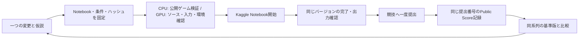

# ARC3 の改善サイクル

公開ゲームは、25本全体も形式・基本的な仕組みを示す **Public Demo** です。
既知3本の実測は接続・回帰確認に使い、候補の汎化性能の合否判定には使いません。
25本への拡張や同じゲームの別seedも未知環境での検証とは扱いません。
本番の判定段階は、コードと条件を固定した候補を競技ゲートウェイが返す環境へ
適用する再実行です。そこで得た Public Score と最終 Private Score も区別します。
ゲームIDで切り替える Explorer の hybrid は、別系統のデモ診断用比較器です。
このサイクルのCPU候補は全ゲートウェイ環境を列挙し、方策へゲームIDを渡しません。
その接続条件だけで未知環境への汎化が証明されるわけではありません。
出典: [公式技術報告 Table 1 / Section 3.6](https://arcprize.org/media/ARC_AGI_3_Technical_Report.pdf)。

量子回路で使った「候補を固定 → 検証 → Kaggle → 結果を保存 → 次の変更」を、
CPU と GPU の独立した系列に適用します。自動的に改善案を発明する仕組みではなく、
変更の仮説から実行・比較までを追跡し、次の改善を同じ条件で試すための実行基盤です。

公式ZIPとの接続検査を [CONNECTION_CHECKS.md](CONNECTION_CHECKS.md) に追加しました。
新しいNotebookの開始と競技提出には、同じコードの接続検査結果が必要です。
CPUの実ゲーム検証も、ZIP内の `arc-agi 0.9.8` / `arcengine 0.9.3` と
ZIP原文の `Agent.main()` を使う経路に揃えました。過去の結果は保持します。



## 二つの系列

| 系列 | 基準 | 最初の比較対象 | 実行資源 |
|---|---|---|---|
| CPU | 既存 Coverage c8b | `cpu-c8b-probe64`: 停滞時の探索介入を96手から64手へ | Kaggle CPU |
| GPU | Franzen Milestone 2 V3 | 既存 evidence-memory v1 | Kaggle RTX Pro 6000 |

GPU 基準版と記憶版は同じ `gpu-environment.json` を共有します。元 V3 の正確な
Notebook バージョン `/3` から環境イメージと入力参照を読み戻します。
読み戻せない場合や入力が保存監査と食い違う場合は、推測で置換せず停止します。
モデル参照は V1 を指定しています。API が返すデータセット参照に版番号が含まれる
場合は保持します。版のないデータセット参照では、入力内容の不変性までは保証しません。
公式スコアを比較するときは、設定値に加えて Kaggle から読み戻した実際の環境イメージも
一致することを確認します。実行環境が更新された比較はそのまま改善とは判定しません。

CPU と GPU を一本のスコア改善率にまとめません。公開ゲーム内の再現、Kaggle の
Notebook 完了、公式 Public Score、未知ゲームの成績は区別します。

## 実行場所と既存資産

このサイクルは、既存の Kaggle Secret を持つ `Sumuji-zkdwn/kb-ndtjm` をクラウド
実行基盤として使えます。量子回路の workflow と成果物は変更しません。
ARC 専用の `.github/workflows/arc3-improvement-cycle.yml` を追加します。
元の ARC3 staged evaluation は `primitive-lean` の別系統の比較器で、その PR を
このサイクルの開始条件にはしません。取り込んだ Notebook 原本は読み取り専用です。

`SOURCES.json` と `NOTICE.md` に Notebook の出典とハッシュがあります。
初期 CPU 候補には今回の新規公開3ゲーム検証の記録が付属します。
同一 Notebook バイト列・同一実行設定の場合だけ再利用し、再利用であることを記録します。
方策が変われば新規ゲーム検証が必要です。ゲーム実装は Git や提出 Notebook に追加しません。

## GitHub から動かす

初回 push は `prepare / all` です。秘密情報を使わず、4つの候補の schema・構文・
コード同一性と制御処理を検査し、`arc3-cycle-evidence` artifact を作ります。

main への反映後は Actions の **ARC3 CPU and GPU improvement cycle → Run workflow** を使います。
main に未反映の間も `codex/arc3-cycle-*` ブランチで `request.json` を変更して push すれば、
同じ段階を実行できます。手動実行ボタンが main 反映前にあるとは想定しません。

| stage | 処理 | 引継ぎ |
|---|---|---|
| prepare | 候補固定、構文・ハッシュ照合。実行・提出なし | 任意。初回は空 |
| public-smoke | CPU の正確な Notebook 方策を公開3ゲームで検証 | prepare の run ID |
| start | Notebook を一度開始し、バージョン番号を保存 | CPU は prepare/smoke の run ID。最初の GPU 基準版は空で可 |
| observe | 同じ Notebook バージョンと提出番号の現状を記録 | 直前の run ID |
| collect | 完了・失敗した Notebook の出力と診断を取得。競技提出はしない | start/observe の run ID |
| submit | 完了済みの正確な版・出力を確認し、競技へ一度提出 | start/observe の run ID |
| adopt-kernel | 通信中断後に、既存の正確な Notebook 版を読み戻して引き継ぐ | intent を含む run ID と version |
| reconcile-submission | 通信中断後に、候補マーカーから既存の提出を探して引き継ぐ | intent を含む run ID |

長い GPU 実行中に GitHub runner を待機させません。`observe` はその時点の結果を保存し、
未完了なら再びその run ID を引き継ぎます。時間経過だけで終了や採点成功とは扱いません。
実行を開始する `start` と競技の提出枠を使う `submit` は別操作です。

共通入力は `profile`、`label`、`hypothesis`、`source_run_id` です。
`connection_run_id` は `ARC3 official bundle connection checks` の成功run番号です。
CPUではそのprofileのartifact、GPUではCPU基準版とGPU両方を確認したartifactを
取得し、Notebookコードのハッシュを照合します。検査結果を引き継いだ後は省略できます。
`all` は prepare 専用。live の各段階は候補を一つ選びます。
各段階の artifact 全体を次に引き継ぐので、CPU/GPU の履歴は同じ台帳内でも別のフォルダーです。

### 最初の CPU 基準実行

1. 初回 prepare の artifact を確認します。
2. `stage=start`、`profile=cpu-c8b`、`label=baseline-20261029`、`source_run_id=prepareの番号`。
   初期 c8b は byte-identical な公開3ゲーム検証を再利用できます。
3. `observe` で同じバージョンの完了を確認します。
   `collect` で出力・診断を確認してから、競技採点へ進めます。
4. 競技採点へ進む際は `submit` を実行します。
5. `observe` で公式 Public Score が確定するまで同じ提出番号を追います。

### 最初の GPU 比較

1. `start / gpu-baseline / baseline-20261029`。初回の `source_run_id` は空。
   元 V3 の環境・入力を読み戻してから固定します。
2. `observe` で基準 Notebook の完了を確認します。
3. その artifact を引き継ぎ、`start / gpu-memory / memory-v1`。
   `baseline_label=baseline-20261029` とします。基準版の完了前には開始しません。
4. それぞれの Notebook 出力・エラー・時間を確認し、必要な候補を `submit` します。
5. 公式採点後に同系列内で比較します。

RTX Pro 6000 の割当可否、使用可能時間、V3 の入力へのアクセス、実際の所要時間は
Kaggle 側の現在の状態に依存します。初期設定の session timeout は9時間ですが、
隠しゲームの実行がその時間内に収まることを検証した値ではありません。

必要な Actions Secret は `KAGGLE_API_TOKEN`。量子回路側に既にあるものをそのまま使い、
値を Notebook や Git、ログへ移しません。`public-smoke` はKaggleの競技ZIPから
公開環境を取得するため、同じ `KAGGLE_API_TOKEN` を使います。このサイクルの
公式ZIP検査、ローカル公開環境実行、Kaggle実行には `ARC_API_KEY` は必要ありません。

## 次の改善を試す

一回に一つの変更と仮説を記録します。例は「停滞後の探索予算を変える」や
「記憶再読が失敗操作の反復を減らすか」です。元の基準 Notebook を上書きせず、
別の notebook または新しい版の候補として固定します。

CPU は突破レベル、勝敗、初期 RESET を含む操作数、時間、例外を比較します。
GPU は基準版と記憶版で同じ環境・入力・予算を使い、Notebook の診断と
最終的な公式スコアを別々に記録します。既知3ゲームでの成功や単発 Public Score の
改善だけで、未知ゲームへの一般化や記憶機構単独の因果効果を結論しません。

```powershell
python -m pip install -r experiments/arc3/cycle/requirements.txt
python experiments/arc3/cycle/cycle.py prepare --profile cpu-c8b --notebook path/to/new.ipynb --label c9-one-change --hypothesis "one concrete change" --out runs/cpu/c9
python experiments/arc3/cycle/cycle.py attach-connection --bundle runs/cpu/c9 --report path/to/matching-connection-report.json
python experiments/arc3/cycle/cpu_smoke.py --bundle runs/cpu/c9 --environments path/to/public-environments --official-zip path/to/arc-prize-2026-arc-agi-3.zip
python experiments/arc3/cycle/cycle.py start --bundle runs/cpu/c9
python experiments/arc3/cycle/cycle.py observe-kernel --bundle runs/cpu/c9
python experiments/arc3/cycle/cycle.py submit --bundle runs/cpu/c9
python experiments/arc3/cycle/cycle.py observe-score --bundle runs/cpu/c9
python experiments/arc3/cycle/cycle.py compare --baseline runs/cpu/baseline --candidate runs/cpu/c9 --out comparison.json
```

CPU 公開ゲームの実行には公式ZIP内の `arc-agi==0.9.8` と `arcengine==0.9.3`
およびその依存が必要です。`cpu_smoke.py --official-zip <ZIP>` はZIP内の
SDKと公式Agent原文を使います。Linuxの依存wheelは同梱されているため、
ActionsではPython 3.12でそのまま取得・インストールします。
APIを呼ぶコマンド以外は Kaggle 認証をしません。

## 重複と中断

候補ごとに固有の Notebook slug を使います。開始前に既存 Notebook を確認し、
同じ候補を新しい runner から誤って上書きしません。変更 API の前に intent を
保存し、通信結果が不明なときは自動再試行しません。既に記録された Notebook の
version / submission ref を再利用し、別候補の receipt は拒否します。
公式スコアの `0` も正常値として扱います。

## 検証

```bash
python -X utf8 -m unittest discover -s experiments/arc3/cycle -p test_cycle.py -v
python -X utf8 experiments/arc3/cycle/runner.py --offline-all --root build/offline
```

制御テストは API の偽物を使い、認証・GPU使用・提出をしません。
`baseline-evidence/cpu-public-smoke.json` は別に実行した実ゲーム検証です。
CPUのローカル実測とGPUの静的準備を同じ「動作確認済み」にまとめません。
