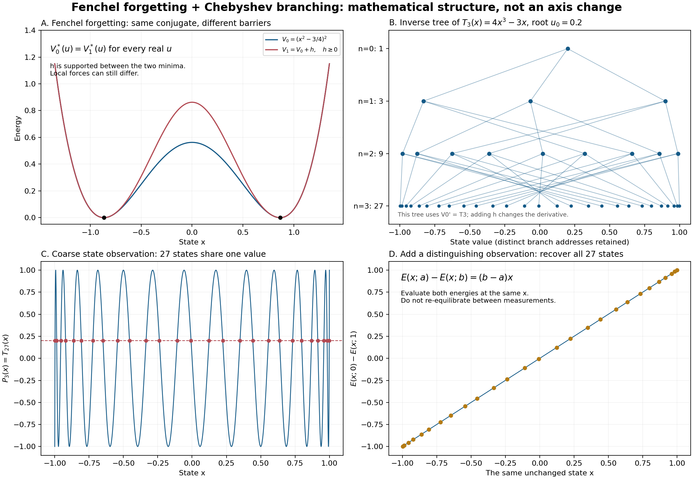

# フェンシェル忘却・三分岐・既存の状態／観測／履歴の接続

2026-10-29時点の研究チェックポイントです。内部状態・観測・履歴の関係は既存資料に定義され、有限系の実行可能な検査器もあります。人間予測ループv0.2には、その検査器と実ログ・探索判断をつなぐ処理がまだ入っていません。

ここでは既存コードの原形、数値図、再実行結果、次に接続する範囲を保存します。新しい認知理論の確立、人間の気づきの同定、ARC方策への統合、公式得点の改善を報告するものではありません。

## 3^nの意味

エネルギー `E(x;u) = x^4 - 3*x^2/2 - u*x` の停留条件は `T3(x)=u`、`T3(x)=4*x^3-3*x` です。`T_m(cos θ)=cos(mθ)` より `T3` のn回合成は `T_(3^n)` です。`-1<u<1` の逆像は `(-1,1)` に相異なる `3^n` 個あります。nは逆像をたどる深さです。[NIST DLMF 18.5.1](https://dlmf.nist.gov/18.5.E1)

一段の三根は二つの極小と一つの極大に対応します。反復した逆像すべてを、元の四次エネルギーの安定平衡と呼ぶことはできません。図の定数 `9/16` はエネルギーを上下に移すだけで、導関数を変えません。



- A：`V0=(x^2-3/4)^2` と、二つの極小の間にだけ非負の障壁hを足した `V1=V0+h` は、すべての実入力uについて同じフェンシェル共役を持ちます。hの形と係数0.3は今回の図のための選択です。
- B：`V0'=T3` の逆像木。内点 `u0=0.2` に対して1、3、9、27状態へ分岐します。
- C：状態観測を `P3=T27` にすると、同じ観測値に27状態が対応します。
- D：同じ状態xで二つの入力に対するエネルギーを評価すれば `E(x;a)-E(x;b)=(b-a)*x` から状態を区別できます。測定の間に別々の平衡へ移す操作にはそのまま適用できません。

フェンシェル共役がエネルギー関数を同一視することと、Pnが状態を同一視することは異なる関係です。hを加えると導関数も変わるため、V1にも同じT3の逆像木が残るとは主張しません。

共役の等しさは次の不等式で確認できます。`a=sqrt(3)/2`、`u>=0`、`-a<x<a` に対し、`V0(x)-u*x - (V0(a)-u*a) = V0(x)+u*(a-x)>0`。`u<=0` では比較点を-aにします。大域最小点はhの支持の内部に入らず、外側の関数は同じなので共役も一致します。局所力学の同一性は従いません。

[SVG](figures/fenchel-chebyshev-3n.svg) / [図の生成時の数値記録](figures/checks.json)

## 既存の関係と実装

| 対象 | 既存資料・コード | 保持する内容 |
|---|---|---|
| 状態・操作・観測 | Flow Calculus r2のFORMAL_SPEC | `step : A -> S -> Option S`、`q : S -> O`、操作列の実行と部分性 |
| 継続同値 | 原始の操作と忘却の導出、第6節 | `x ~ y iff forall w, obs(w,x)=obs(w,y)`。現在の観測一致だけでは統合しない |
| 将来の識別 | [primitive.py](sources/primitive/primitive.py) | `future_partition`、`distinguishing_word`、`extension_report`、`quotient` |
| 不確実な検査結果 | [Flow finite.py](sources/flow/finite.py) | `distinguish`は`distinguished`、`equivalent`、`unknown_budget`を区別 |
| 履歴を持つ模型 | 原始の形式化、第7章 | 指定した有限内部更新則と帰還系。任意の認知状態への同定保証ではない |

コピーした3モジュールは元ファイルとバイト単位で一致します。原本の場所とSHA-256は [provenance.json](provenance.json) に記録しています。元の長い研究本文や会話は同梱せず、文書ハッシュと参照箇所を残します。Flowの [examples.py](sources/flow/examples.py) も元のままです。

全域決定的なprimitiveと、部分操作を許すFlowには前提の違いがあります。どちらも完全に指定した有限表についての検査です。未調査のARC遷移を「適用不能」として完全表へ埋めてはいけません。成功・費用も保存したい場合は、それらを出力や状態に明示して、対応する同値を調べます。

## 今回の再実行

```sh
python -B experiments/arc3/human_loop/research/verify_existing.py
```

標準ライブラリだけで実行できます。結果を保存する場合は `--output build/structure-checks.json` を追加します。

- 既存三状態模型の `AB(2)=0` と `BA(2)=1` は現在の観測が共に0。その後のBで観測0と1に分かれ、最短識別列Bを返します。コードの語は実行順なので、数学のABは`['B','A']`です。
- 観測だけで状態0と1を統合する商を検査器が拒否します。
- Flowの既存hidden_load例はpushで区別でき、探索予算ゼロでは`unknown_budget`を返します。
- 深さ1〜4で、3、9、27、81個のチェビシェフ逆像と残差を数値検算します。全nについての主張は上記の恒等式によるもので、この有限検算だけによるものではありません。
- 同じ状態での二入力エネルギー差を検算し、同梱したコードと図のSHA-256を照合します。

[今回の結果](verification/existing-relations.json)。Leanは今回再ビルドしていません。CIの構造検査はこれらの有限例と保存物の整合性を確認します。

## 人間予測・探索判断への接続仕様（未実装）

1. 実ログを状態候補、観測、入力、経過時間、履歴に対応づける。推定した内部状態を観測済みの正解として扱わない。
2. 三分岐の候補を保持し、採用した観測と後続操作に対して同値かを調べる。予算内で区別できない候補は未判定として残す。
3. 人間参照分布、エージェント自身の成功予測、候補間で応答が分かれる操作列を合わせる。人間の成功見込みをエージェントの成功確率に置き換えない。
4. 継続・識別のための試行・リセット・撤退について、手数、失敗後の状態、情報による次の判断の改善、他課題への機会費用を比較する。識別できる操作が常に有益とは限らない。
5. 直近の進捗と情報獲得を分けて記録し、人間データへの予測と公開デモで検証する。人間の確率的応答には、決定的な同値検査に加えて予測分布と不確かさの扱いが必要。

v0.2の条件付き行動分布・待ち時間分布と、この構造模型の統合は未実施です。既に見た最終評価を使い直す比較は探索的な比較になります。

## 継続運用の接続仕様（未設定）

[既存engine.py](../engine.py)には有限バッチ、候補ごとの保存、再開、OSロック、STOPがあります。外側から有限バッチを反復起動し、同じチェックポイントへ戻す構成を想定します。新しいコード版では新しい実験出力先を使い、評価確定済みのrunへ候補を追加しません。

定期起動、常駐監督、異常時の再起動、通知はこのチェックポイントでは設定していません。停止指示を維持し、通知は意味のある変化・完了・異常・ユーザー判断が必要な場合に限定する運用を想定します。公式提出は手動です。既存CIの自動検査と、人間モデルの定期探索は別の処理です。
